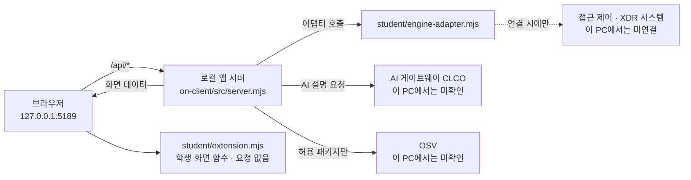

# 케셰브 학생 실행 설명서 (13~21단계)

케셰브는 회사 직원이 자기 로그인 상태, 업무 앱 접속 판정, 최근 보안 기록, AI 설명, 조치 상태, 설치 패키지 취약점 조회를 보는 보안 Agent 앱입니다. 이 문서는 학생이 구현한 부분과 제공 코드의 경계, 실행 방법, 장애 확인 순서를 적습니다. 비밀값은 적지 않습니다.

## 1. 확인한 환경

| 항목 | 값 | 확인 방법 |
|---|---|---|
| OS | Windows 11 Home | 실제 사용 환경 |
| Node.js | 이 PC는 v22.20.0 (`node -v`) | 실제 실행으로 확인 |
| npm | 10.9.3 (`npm -v`) | 실제 실행으로 확인 |
| `on-client/package.json`의 `engines.node` | 24.19.0 (수업 검수 기준) | 파일 내용 |
| 외부 npm 의존성 | 없음 (`on-client/package.json`에 dependencies 없음) | 파일 내용 |

- 이 PC의 Node.js 22.20.0에서 서버가 켜지고 `GET /` 응답 200을 받은 것까지 확인했습니다. Node.js 24.19.0에서는 실행하지 않았으므로 **미확인**입니다.
- Windows 외 OS, 다른 브라우저는 확인하지 않았습니다. 지원 여부는 **미확인**입니다.

## 2. 폴더 구조

```
choi-bujang-secret-vault/        Git 최상위 (커밋·제출 기준)
├─ README.md, docs/              1~12단계 가상 메모 자료실 문서 (이 문서도 docs/)
├─ api/, src/, public/           1~12단계 자료실 서버 (Vercel 배포용, 이번 단계에서 수정하지 않음)
└─ on-client/                    13~22단계 케셰브 앱 폴더
   ├─ package.json               scripts: start, demo, check
   ├─ .env.example               비밀 없는 설정 견본 (ON_PORT 등)
   ├─ tools/start-alekov.ps1     실행 도구 (제공)
   ├─ src/server.mjs             로컬 앱 서버 (제공)
   ├─ src/engine.mjs             엔진 어댑터 로더 (제공)
   ├─ src/ai/, src/actions/, src/vulnerabilities/   AI·조치·OSV 조회 (제공)
   ├─ public/index.html, app.js  화면 (제공, 수정 금지)
   └─ student/extension.mjs      학생이 구현한 화면 함수
      student/engine-adapter.mjs 엔진 연결 어댑터 (제공 기본값: 연결 없음)
```

## 3. 실행 절차

1. 파일 탐색기에서 `on-client` 폴더를 엽니다. 주소 표시줄에 `powershell`을 입력하고 Enter를 누르면 그 폴더에서 새 PowerShell 창이 열립니다.
2. 아래 중 한 가지를 실행합니다.

```powershell
npm start
```

또는 제공 실행 도구(Node.js 버전·포트를 미리 확인):

```powershell
powershell -NoProfile -ExecutionPolicy Bypass -File .\tools\start-alekov.ps1
```

3. 브라우저에서 `http://127.0.0.1:5189/` 를 엽니다. 서버는 `127.0.0.1`에만 열리며 기본 포트는 5189입니다(`ON_PORT`로 바꿈).
4. **정상 시작 신호**: 서버 창에 `케셰브 연결 확인: http://127.0.0.1:5189` 한 줄이 나옵니다(직접 확인한 출력은 포트 5199로 실행했을 때의 같은 형식입니다). `npm run demo`로 켜면 `케셰브 예제: ...`로 나옵니다. `ExperimentalWarning: SQLite` 경고는 함께 나올 수 있으며 이번 확인에서는 실행에 영향이 없었습니다.
5. **종료**: 서버를 켠 PowerShell 창에서 `Ctrl+C`.
6. **재실행**: 같은 폴더에서 2번 명령을 다시 실행합니다. 포트가 사용 중이면 `.\tools\start-alekov.ps1 -Port 5190` 또는 `ON_PORT`를 바꾸고 주소의 포트도 바꿉니다.
7. 문법 점검: `npm run check` (`student/extension.mjs`의 문법만 확인하며 동작 검증이 아닙니다).

`npm run demo`는 예제 자료로 화면만 보여 주며 실제 연결·성취가 아닙니다.

## 4. 시스템 구성도

### 글로 쓴 설명

1. 브라우저가 `http://127.0.0.1:5189/` 의 화면(`public/index.html`, `public/app.js`)을 엽니다.
2. 화면은 같은 서버의 `/api/...` 경로만 호출합니다(`/api/me`, `/api/apps`, `/api/access`, `/api/events`, `/api/devices`, `/api/sessions`, `/api/vulnerabilities`, `/api/ai/check`, `/api/ai/explain`, `/api/actions/*`, `/api/diagnostics`).
3. 로컬 앱 서버(`src/server.mjs`)는 접근 제어·XDR 쪽 자료를 엔진 어댑터(`student/engine-adapter.mjs`)로만 읽습니다. 기본 어댑터는 `evidenceMode: 'disconnected'`라 연결이 없으면 `ENGINE_NOT_CONNECTED`(503)를 돌려줍니다.
4. AI 설명은 서버의 `src/ai/`가 AI 게이트웨이(CLCO)로 요청합니다. 키·토큰은 서버 쪽 보관소에만 있고 화면과 이 저장소에는 없습니다.
5. 설치 패키지 조회는 서버의 `src/vulnerabilities/`가 `package-lock.json`을 읽고, 허용 목록(`ON_APPROVED_PUBLIC_PACKAGES`)에 있는 공개 패키지만 OSV에 조회합니다.
6. 서버는 각 응답을 검사한 뒤 화면 제공 코드가 `student/extension.mjs`의 함수(`renderIdentity` 등)에 `{status, mode, data, error}` 형태로 넘기고, 학생 함수는 DOM만 만듭니다. 학생 함수는 요청을 보내지 않습니다.

### Mermaid



### 표

| 구간 | 방향 | 주소·파일 | 이 PC에서 확인한 것 |
|---|---|---|---|
| 브라우저 → 앱 서버 | HTTP | `http://127.0.0.1:5189/` | `GET /` 200 확인 |
| 앱 서버 → 엔진 어댑터 | 함수 호출 | `student/engine-adapter.mjs` | 기본 `disconnected` 확인 |
| 엔진 → 접근 제어·XDR | 호스트 설정 시에만 | 운영 측 제공 | 미연결, **미확인** |
| 앱 서버 → AI 게이트웨이 | HTTPS | `src/ai/` | 호출하지 않음, **미확인** |
| 앱 서버 → OSV | HTTPS | `src/vulnerabilities/` | 호출하지 않음, **미확인** |

## 5. 구현 범위 표

| 단계 | 함수 (`student/extension.mjs`) | 구분 | 직접 확인한 것 | 미확인 |
|---|---|---|---|---|
| 13 | `renderIdentity` | 학생 구현 | 이전 단계 기록 기준 | 실제 연결 화면 |
| 14 | `renderDecision` | 학생 구현 | 이전 단계 기록 기준 | 실제 판정 연결 |
| 15 | `renderEvents` | 학생 구현 | 이전 단계 기록 기준 | 실제 사건 목록 |
| 16 | `renderStatus` | 학생 구현 | 이전 단계 기록 기준 | 실제 알림 |
| 17 | `renderAiConnection` | 학생 구현 | 이전 단계 기록 기준 | 실제 AI 연결 |
| 18 | `renderExplanation` | 학생 구현 | 모의 데이터 6가지(Node, DOM 대역) | 실제 화면, 실제 AI 설명 |
| 19 | `renderAction` | 학생 구현 | 모의 데이터 6가지(Node, DOM 대역) | 실제 화면, 조치 준비·집행·재조회(지원 조치 없음) |
| 20 | `renderVulnerabilities` | 학생 구현 | 모의 데이터 4가지(Node, DOM 대역) | 실제 화면, 실제 OSV 조회 |
| 제공 | `src/*`, `public/*`, `tools/*` | 제공 코드 (수정하지 않음) | 서버 시작과 `GET /` 200, `/api/events` 503 | 그 외 경로 전체 |

- 학생 함수는 `createElement`와 `textContent`로만 DOM을 만듭니다. 버튼·요청·확인 번호·토큰을 만들거나 저장하지 않습니다.
- 지금 보안 기록의 지원 조치(`supportedActions`)가 비어 있어 조치 준비 버튼이 나오지 않는 것이 정상입니다.
- 모의 데이터 점검은 실제 심판 판정이 아닙니다.

## 6. 장애 확인 순서

| 증상 | 확인 방법 | 복구 |
|---|---|---|
| 주소가 열리지 않음 | 서버 창이 켜져 있고 `케셰브 연결 확인:` 줄이 있는지 | 2·3장 명령으로 다시 실행 |
| 포트 사용 중 | 시작 도구 메시지 또는 서버 오류 | `-Port 5190`으로 실행하고 주소의 포트도 변경 |
| 화면에서 `ENGINE_NOT_CONNECTED` / 기록·신원 조회 실패 | 이 코드는 엔진 연결 없음이며 학생 코드 오류가 아님. `curl http://127.0.0.1:5189/api/events`로 확인 | 연결은 담당자 안내(`on-client/docs/SDP_HOST_CONNECTION.md`)에 따름. 화면 표시만 확인할 때는 `npm run demo` |
| `ENGINE_RESULT_UNVERIFIED` | 응답 형식 불일치. 정상으로 보지 않음 | 연결 계약 확인 후 다시 불러오기 |
| AI 오류 코드 (`WB_CLCO_*`, `ON_AI_*`) | 화면에 표시된 코드 | `on-client/docs/CONNECTION_TROUBLESHOOT.md`의 코드 표를 따름 |
| 패키지 조회 `not_configured` / `not_checked` | 허용 목록·프로젝트 경로가 비어 있으면 정상 | 설정은 운영자가 준비. 학생이 임의로 바꾸지 않음 |
| 패키지 조회 `partial` / `unverifiable` | 받은 ID는 유지됨. 조회 실패는 취약점 없음이 아님 | 직접 다시 조회 |
| 문법 오류 | `npm run check`의 첫 오류 | 그 줄만 수정 후 재실행 |

## 7. 비밀값 규칙

- `.env`, 키, 토큰, 비밀번호는 이 문서와 Git에 없습니다. 설정 견본은 `on-client/.env.example`(비밀 없음)입니다.
- `bundle-notes.json`, `artifacts/submission.json`은 커밋하지 않습니다.

## 8. 미확인 항목 요약

- Node.js 24.19.0에서의 실행
- 제공 실행 도구(`start-alekov.ps1`)의 실제 실행
- 실제 엔진·AI 게이트웨이·OSV 연결 및 응답
- 18~20단계 함수의 실제 화면 동작
- 21단계 비공개 원문 묶음 제출과 AI 판정 결과
